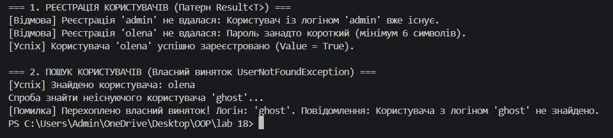

# Лабораторна робота №18. Власні винятки та патерн Result

Варіант: 2. Управління користувачами  

Мова програмування: C#  

## Мета роботи

Навчитися створювати власні типи винятків для специфічних помилок, а також реалізовувати патерн Result для більш контрольованої обробки помилок без використання винятків у «нормальних» сценаріях невдачі.

## Опис роботи

Програма демонструє поєднання двох підходів до обробки помилок на прикладі сервісу управління користувачами:

* **Власний виняток `UserNotFoundException`:** Клас успадковується від `System.Exception`, містить додаткову властивість `Username` та стандартні перевантаження конструкторів для передачі контексту помилки.
* **Узагальнений клас `Result<T>`:** Реалізовано обгортку результату з властивостями `IsSuccess`, `Value`, `Error`, приватним конструктором та статичними фабричними методами `Success(T value)`, `Failure(string error)` і `Failure(Exception ex)`.
* **Клас сервісу `UserService`:**
  * Метод `GetUser(string username)` шукає користувача в колекції та викидає `UserNotFoundException`, якщо запис відсутній.
  * Метод `RegisterUser(string username, string password)` виконує валідацію (перевіряє унікальність логіна та довжину пароля) і повертає `Result<bool>.Success(true)` або `Result<bool>.Failure(...)` без генерації винятків.
* **Демонстрація в `Main`:** Перевірено реєстрацію з дублікатом логіна, занадто коротким паролем, успішну реєстрацію нового користувача (через перевірку `IsSuccess` та `Error`), а також пошук існуючого й неіснуючого користувача з перехопленням `UserNotFoundException` у блоці `try-catch`.

### Результат виконання програми
 

## Висновок

Під час виконання лабораторної роботи було освоєно створення власних класів винятків та патерну `Result<T>`. Вибір між цими підходами для методів вашого варіанта є повністю обґрунтованим: під час реєстрації (`RegisterUser`) помилки на кшталт зайнятого логіна чи короткого пароля є очікуваними штатними ситуаціями, тому патерн `Result<T>` дозволяє обробити їх швидко та без витрат ресурсів на розгортання стека винятків. Натомість у методі `GetUser` відсутність запитуваного користувача порушує контракт отримання об'єкта, тому генерація типізованого винятку `UserNotFoundException` чітко сигналізує про неможливість продовжити роботу та передає ім'я проблемного користувача.

## Контрольні запитання

1. Навіщо створювати власні типи винятків? Які переваги це дає?
* Власні винятки дозволяють точно виразити специфічну помилку предметної області (наприклад, `UserNotFoundException` замість загального `Exception`).
* Це дає змогу вибірково перехоплювати саме такі помилки у блоках `catch` та передавати додаткові дані через власні властивості (наприклад, `Username`).

2. Які стандартні конструктори рекомендується реалізовувати для власних винятків?
* Рекомендується реалізовувати конструктор без параметрів, конструктор із рядковим повідомленням (`string message`) та конструктор із повідомленням і внутрішнім винятком (`string message, Exception innerException`), щоб зберегти ланцюжок причин помилки.

3. Поясніть патерн Result. У яких випадках його використання є більш доцільним, ніж викидання винятків?
* Патерн `Result<T>` інкапсулює результат операції в один об'єкт, який містить або успішне значення (`Value`), або опис помилки (`Error`) з прапорцем `IsSuccess`.
* Його доцільно використовувати для очікуваних сценаріїв невдачі: валідації форм, перевірки пароля, бізнес-обмежень (наприклад, логін уже зайнятий), де помилка не є аварійною ситуацією.

4. Які сценарії краще обробляти через винятки, а які через патерн Result?
* **Через винятки:** непередбачувані, критичні або інфраструктурні збої, коли метод не може виконати свою задачу (втрата зв'язку з БД, відсутність файлу, порушення контрактів, передача `null`).
* **Через патерн Result:** типові, передбачувані помилки користувача або бізнес-логіки (неправильний формат даних, дублікат запису, недостатньо прав чи коштів для дії), які є нормальною частиною потоку виконання програми.
