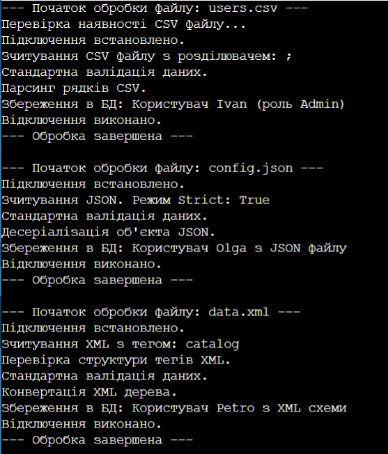

# ЗВІТ
## З лабораторної роботи №11
**Тема:** DocumentProcessor: шаблонні кроки й реалізації.

**Мета:** Навчитися використовувати абстрактні класи для реалізації патерну Template Method, створювати загальну логіку обробки в базовому класі та специфічну логіку в похідних класах.

### Хід роботи:
1. Створив проєкт та реалізував абстрактний базовий клас DataImporter із шаблонним методом Import(), який викликає 6 кроків у чіткій послідовності.
2. Додав властивості стану, абстрактні методи для обов'язкової реалізації та віртуальні методи зі стандартною логікою.
3. Створив 3 похідні класи (CSVImporter, JSONImporter, XMLImporter) з унікальними властивостями та перевизначеною логікою під конкретні формати.
4. Продемонстрував поліморфну роботу об'єктів у методі Main через список базового типу.

### Результат виконання програми

### Відповіді на запитання:

**1. Що таке патерн Template Method і для чого він використовується?**
Це патерн, який фіксує скелет алгоритму в базовому класі, але дозволяє похідним класам змінювати реалізацію окремих етапів, не порушуючи загальний порядок кроків.

**2. Яка різниця між абстрактними та віртуальними методами в контексті цього патерну?**
Абстрактні кроки не мають коду в базовому класі — похідні класи обов'язково повинні написати свою логіку. Віртуальні кроки вже мають готовий стандартний код, який за потреби можна змінити (перевизначити).

**3. Які переваги дає винесення спільної логіки в базовий клас?**
Це прибирає дублювання коду, спрощує підтримку (алгоритм змінюється в одному місці) та дозволяє легко дописувати нові класи-наслідники без переписування основної програми.

**4. Коли доцільно використовувати Template Method замість інтерфейсів?**
Коли об'єкти мають спільний готовий каркас дій (алгоритм), де змінюються лише деталі кроків. Інтерфейси ж просто змушують класи реалізувати методи, але не задають порядок їх виконання.

**5. Наведіть приклад з реального життя, де застосовується цей патерн.**
Приготування чаю та кави. Процес однаковий: закип'ятити воду, засипати інгредієнт, налити в чашку, додати топінг. Але сам інгредієнт і топінг (специфічні кроки) відрізняються.

**Висновок:**
На лабораторній роботі я навчився застосовувати патерн Template Method, створювати гнучкі абстрактні класи та розділяти загальну архітектуру програми від деталей її реалізації.
