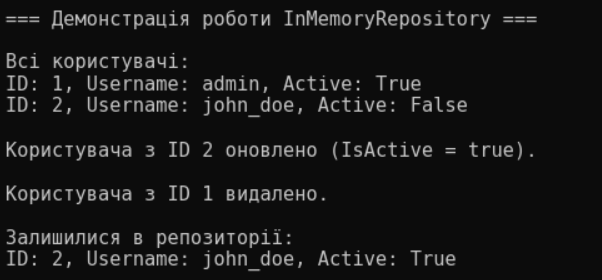
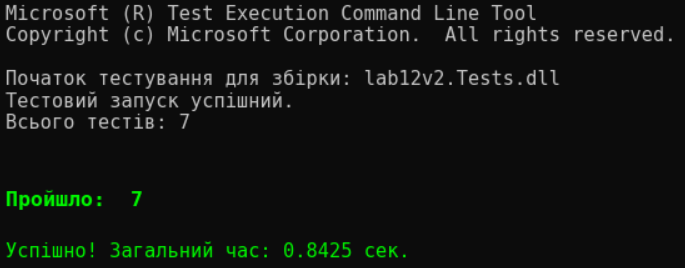

# ЗВІТ
## З лабораторної роботи №12
**Тема:** Узагальнені типи (Generics). Реалізація патерну Репозиторій (Repository) з where-обмеженнями та покриття коду Unit-тестами.

**Мета:** Навчитися створювати узагальнені інтерфейси та класи в C#, використовувати обмеження узагальнень (`where`), реалізувати збереження сутностей у пам'яті за допомогою патерну Repository, а також опанувати базові принципи модульного тестування (Unit Testing) за допомогою фреймворку xUnit.

### Хід роботи:
1. Створив(ла) рішення (Solution) та два пов'язані проєкти: консольну програму `lab12v2` та тестовий проєкт `lab12v2.Tests`.
2. Описав(ла) інтерфейс `IEntity` з базовою властивістю `Id` та реалізував(ла) сутність `User` (Варіант 2) із додатковими полями `Username`, `Email`, `IsActive`.
3. Створив(ла) узагальнений інтерфейс `IRepository<T>` та його реалізацію `InMemoryRepository<T>` для збереження даних у колекції `List<T>` з використанням where-обмеження `where T : IEntity`.
4. Реалізував(ла) демонстрацію виконання всіх CRUD-операцій (додавання, читання, оновлення, видалення) у файлі `Program.cs`.
5. Створив(ла) набір юніт-тестів у проєкті `lab12v2.Tests` для повної перевірки працездатності репозиторію, включаючи тестування виключних ситуацій (`ArgumentException`, `KeyNotFoundException`).

### Результат виконання програми

### Відповіді на запитання:

**1. Що таке узагальнення (Generics) в C# та які їхні головні переваги?**
Узагальнення — це механізм, який дозволяє створювати класи, інтерфейси, структури чи методи, де тип даних, з якими вони працюють, вказується як параметр під час оголошення (наприклад, `<T>`). Головні переваги — перевикористання коду для різних типів, безпека типів на етапі компіляції (Type Safety) та відсутність втрат продуктивності на пакування/розпакування (boxing/unboxing).

**2. Навіщо потрібні обмеження типів (where) в узагальненнях?**
Обмеження `where T : IEntity` вказують компілятор, що параметр типу `T` зобов'язаний реалізовувати певний інтерфейс, походити від конкретного класу або мати конструктор за замовчуванням. Без цього обмеження всередині репозиторію ми не змогли б звертатися до властивості `item.Id`, оскільки компілятор не знав би, які саме поля є в абстрактного типу `T`.

**3. Що таке патерн проектування "Репозиторій" (Repository)?**
Це архітектурний патерн, який виступає посередником між бізнес-логікою програми та рівнем доступу до даних (базою даних, файлами або оперативною пам'яттю). Він інкапсулює в собі всі операції пошуку, додавання, зміни та видалення об'єктів (CRUD), дозволяючи решті програми не залежати від того, де і як саме ці дані зберігаються.

**4. Для чого використовуються методи Assert у Unit-тестах?**
Методи класу `Assert` (наприклад, `Assert.NotNull`, `Assert.Equal`, `Assert.Throws`) використовуються для перевірки відповідності між очікуваним результатом роботи коду та фактичним результатом, який повернула програма. Якщо хоча б один `Assert` не виконується, тест вважається проваленим, що сигналізує про помилку в коді.

**5. Чому важливо тестувати не лише успішні сценарії, а й виключні ситуації (Exceptions)?**
Тестування виключних ситуацій гарантує, що програма веде себе передбачувано та безпечно під час виникнення помилок (наприклад, при спробі видалити неіснуючий ID або додати дублікат). Перевірка через `Assert.Throws` дозволяє переконатися, що система вчасно реагує на некоректні дії користувача та викидає правильні типи помилок замість раптового аварійного завершення роботи.

**Висновок:**
На лабораторній роботі я опанував(ла) роботу з узагальненнями (Generics) на прикладі патерну `Repository` та навчився(лася) обмежувати параметри типів за допомогою ключового слова `where`. Також я здобув(ла) практичні навички написання модульних xUnit тестів для автоматичної перевірки коректності бізнес-логіки та обробки виключень.
