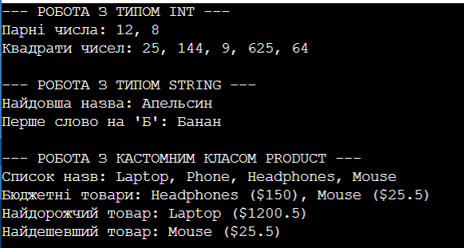

Звіт з лабораторної роботи №13

Тема: Generic-методи для повторного використання компонентів: Mapper/MaxBy/Reduce з Func/Action.
Мета: Навчитися створювати узагальнені (generic) методи для повторного використання логіки, використовувати делегати Func<T> та Action<T> як параметри поведінки й реалізовувати типові операції над колекціями.

Хід роботи:
1. Створив(ла) новий консольний проєкт у директорії згідно з варіантом.
2. Реалізував(ла) клас FunctionalUtils з 5 generic методами для другого варіанту: Map, Filter, MaxBy, MinBy, FirstOrDefault.
3. Використав(ла) делегати Func<T, TResult> та Func<T, bool> та додав(ла) обмеження (constraints) where TKey : IComparable<TKey> для методів пошуку.
4. Створив(ла) тестовий клас Product та список об'єктів цього класу з тестовими даними.
5. Продемонстрував(ла) роботу кожного generic методу з різними типами даних (int, string, custom class Product) у методі Main, використовуючи лямбда-вирази, та вивів(ла) результати в консоль.

## Результат роботи програми

Відповіді на запитання:
1. Що таке generic методи і які переваги вони дають? Це методи, які оголошуються з параметрами типу, що дозволяє їм працювати з будь-якими типами даних без прив'язки до конкретного класу. Вони забезпечують повторне використання коду, сувору типізацію на етапі компіляції та відсутність операцій пакування/розпакування, що підвищує швидкодію.
2. Яка різниця між делегатами Func<T> та Action<T>? Делегат Func завжди повертає значення певного типу і може приймати вхідні параметри, тоді як делегат Action призначений для методів, які виконують певну дію і нічого не повертають (void).
3. Що таке функції вищого порядку? Наведіть приклади. Це функції, які приймають інші функції або делегати як вхідні параметри або повертають їх як результат своєї роботи. Типовими прикладами є методи Map, Filter, Reduce, а також стандартні методи розширення LINQ, такі як Where та Select.
4. Навіщо потрібні обмеження (constraints) для generic типів? Вони вказують компілятору, якими властивостями, інтерфейсами чи методами повинен володіти переданий тип даних. Наприклад, обмеження where TKey : IComparable<TKey> гарантує, що ключі можна порівнювати між собою за допомогою методу CompareTo, що необхідно для пошуку максимуму чи мінімуму.
5. Як лямбда-вирази спрощують роботу з делегатами? Вони дозволяють записувати анонімні методи дуже коротко і безпосередньо в місці їх виклику. Завдяки цьому зникає необхідність створювати окремі іменовані методи в класі, що робить код компактнішим та легшим для читання.

Висновок: На цій лабораторній роботі я навчився(лася) створювати узагальнені (generic) методи для роботи з різними типами даних, розібрався(лася) з використанням делегатів Func як параметрів поведінки та практично застосував(ла) обмеження типів для реалізації універсальної логіки обробки колекцій.
