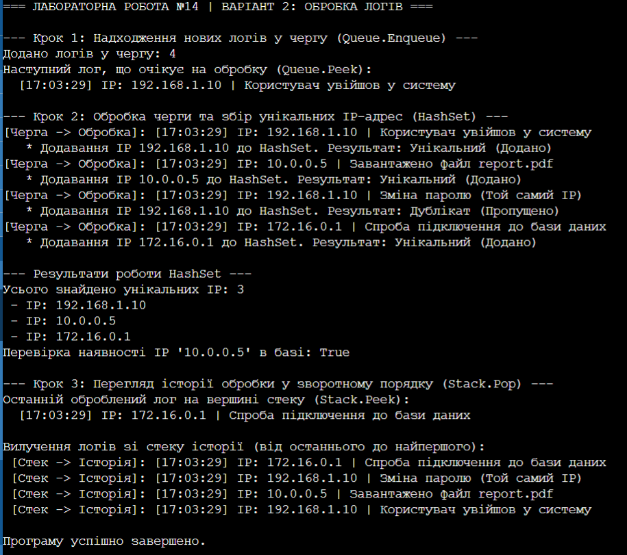

# ЗВІТ
## З лабораторної роботи №14
**Тема:** HashSet/Queue/Stack: практичні сценарії.

**Мета:** Навчитися використовувати спеціалізовані колекції HashSet<T>, Queue<T>, Stack<T> для розв'язання практичних задач, зрозуміти їхні особливості та сценарії застосування.

### Хід роботи:
1. Створив новий консольний проєкт на C# (.NET) у директорії згідно з інструкцією до лабораторної роботи.
2. Реалізував клас LogEntry для представлення даних системних логів (IP-адреса, час події, повідомлення).
3. Застосував колекцію Queue<T> для імітації надходження нових логів та їхньої послідовної обробки за принципом FIFO.
4. Використав колекцію HashSet<T> для автоматичної фільтрації та швидкого збору унікальних IP-адрес із загального потоку логів із часом пошуку O(1).
5. Задіяв колекцію Stack<T> для збереження історії оброблених логів та демонстрації можливості їхнього перегляду у зворотному порядку за принципом LIFO.
6. Продемонстрував роботу всіх колекцій, вивів результати виконання у консоль із детальним описом кожного кроку та перевіркою наявності елементів.

### Результат виконання програми

### Відповіді на запитання:

**1. У чому різниця між List<T> та HashSet<T>?**
List<T> — це впорядкований список, який дозволяє дублікати елементів та надає швидкий доступ за індексом. HashSet<T> — це неупорядкована колекція тільки унікальних елементів, де пошук, додавання та видалення відбуваються значно швидше завдяки хеш-таблицям.

**2. Коли доцільно використовувати Queue<T> замість List<T>?**
Коли потрібно реалізувати чітку дисципліну обробки FIFO (першим прийшов — першим обслужений). Наприклад: черга завдань на друк, черга повідомлень у чаті або фонові задачі сервера, де важливий саме порядок черговості.

**3. Наведіть приклад реальної задачі, де потрібен Stack<T>.**
Функція скасування останньої дії (Undo/Redo) у текстових чи графічних редакторах, історія переходів по сторінках у браузері (кнопка "Назад") або алгоритм обходу дерева/графа вглиб (DFS).

**4. Яка складність операції Contains() для HashSet<T> і чому?**
Складність становить O(1) в середньому (константний час). Це досягається завдяки обчисленню хеш-коду елемента, що дозволяє миттєво визначити його індекс у пам'яті без перебору всієї колекції.

**5. Чому Queue<T> називають FIFO, а Stack<T> — LIFO?**
Queue<T> працює як First In, First Out (перший прийшов, перший пішов) — елемент, який додали найпершим, буде першим вилучений. Stack<T> працює як Last In, First Out (останній прийшов, перший пішов) — елемент, який додали останнім, лежить на вершині й буде вилучений першим.

**Висновок:**
На лабораторній роботі я навчився використовувати спеціалізовані колекції HashSet<T>, Queue<T> та Stack<T> для вирішення практичних задач, засвоїв відмінності в їхній внутрішній структурі та принципах обробки даних (FIFO/LIFO), а також навчився оптимізувати пошук дублікатів за допомогою хешування.
