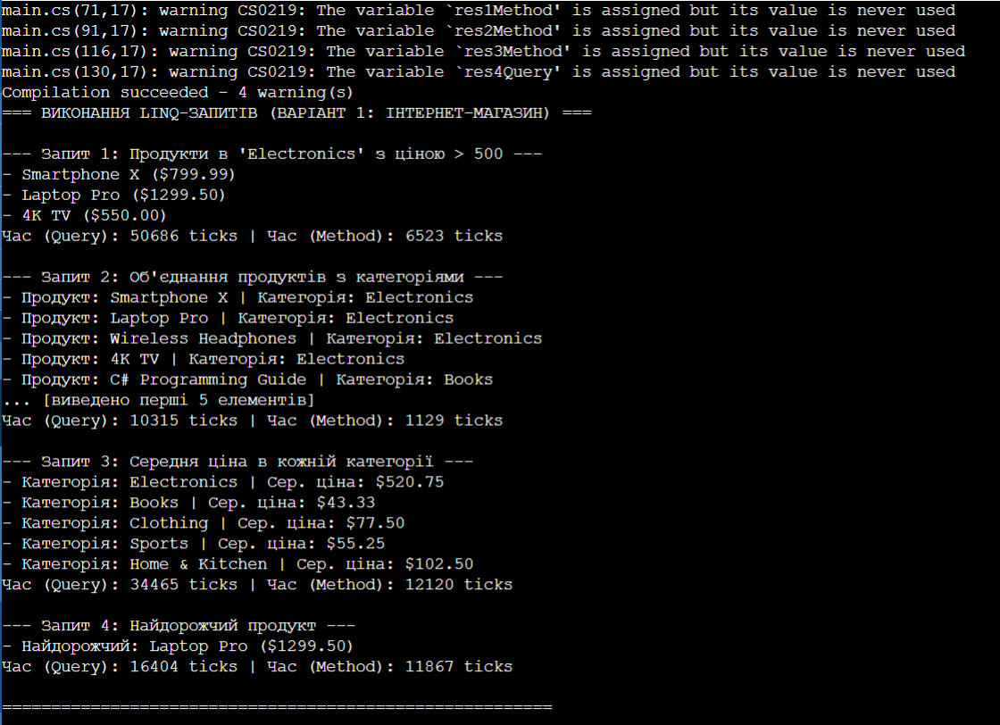

# ЗВІТ
## З лабораторної роботи №15
**Тема:** LINQ в дії: фільтри, join, агрегації. Продуктивність.

**Мета:** Навчитися ефективно використовувати LINQ для фільтрації, об'єднання (join) та агрегації даних, а також аналізувати продуктивність LINQ-запитів.

### Хід роботи:
1. Створив новий консольний проєкт на C# (.NET) у директорії згідно з інструкцією до лабораторної роботи.
2. Реалізував класи сутностей Product (продукт) та Category (категорія) для представлення даних сценарію інтернет-магазину за обраним варіантом.
3. Заповнив колекції об'єктів тестовими даними у кількості 15 елементів для кожної колекції.
4. Реалізував перший LINQ-запит для пошуку всіх продуктів у категорії "Electronics" з ціною понад 500 одиниць, використавши синтаксис запитів (Query) та синтаксис методів (Method).
5. Реалізував другий LINQ-запит для об'єднання (Join) продуктів з їхніми категоріями з подальшим виведенням назви продукту та назви категорії в обох синтаксисах.
6. Реалізував третій LINQ-запит для групування та обчислення середньої ціни продуктів у кожній наявній категорії (Average) в обох синтаксисах.
7. Реалізував четвертий LINQ-запит для пошуку найдорожчого продукту в колекції за допомогою синтаксису запитів та методів розширення.
8. Провів вимірювання часу виконання кожного типу запиту за допомогою класу System.Diagnostics.Stopwatch в одиницях ticks для аналізу їхньої продуктивності та вивів результати в консоль.

### Результат виконання програми

### Відповіді на запитання:

**1. Поясніть різницю між синтаксисом запитів та синтаксисом методів у LINQ. Коли який краще використовувати?**
Синтаксис запитів (Query Syntax) схожий на SQL (from... where... select) і легше читається при складних об'єднаннях та групуваннях. Синтаксис методів (Method Syntax) базується на методах розширення та лямбда-виразах; він є потужнішим, оскільки деякі оператори (наприклад, FirstOrDefault, Take, Skip) існують тільки в ньому. Методів краще вживати для простих фільтрацій, а синтаксис запитів — для об'ємних Join-операцій.

**2. Для чого використовуються операції Join та GroupJoin? У чому їхня відмінність?**
Join використовується для внутрішнього об'єднання (Inner Join) двох колекцій за ключем і повертає плаский результат. GroupJoin виконує ієрархічне об'єднання (аналог Left Outer Join), де для кожного елемента першої колекції формується ціла підколекція зв'язаних елементів з другої колекції.

**3. Наведіть приклади агрегуючих операцій LINQ та поясніть їхнє призначення.**
Sum() — обчислює суму числових значень у колекції. Average() — знаходить середнє арифметичне значення елементів. Count() — підраховує кількість елементів. Max() та Min() — знаходять максимальне чи мінімальне значення відповідно.

**4. Як можна виміряти продуктивність LINQ-запитів? Які фактори впливають на неї?**
Продуктивність вимірюють за допомогою класу Stopwatch, фіксуючи час до і після матеріалізації запиту (виклику .ToList() або ітерації). На продуктивність впливають: відкладене виконання (запит не виконується до моменту звернення), обсяг даних, тип джерела (пам'ять чи БД) та наявність важких операцій на кшталт GroupBy чи вкладених підзапитів.

**Висновок:**
На лабораторній роботі я навчився застосовувати технологію LINQ для фільтрації, об'єднання та агрегації даних у C#, освоїв написання запитів у двох синтаксисах (Query та Method) та дослідив їхній вплив на швидкість роботи програми за допомогою Stopwatch, зробивши висновки щодо ефективності оптимізації коду.
