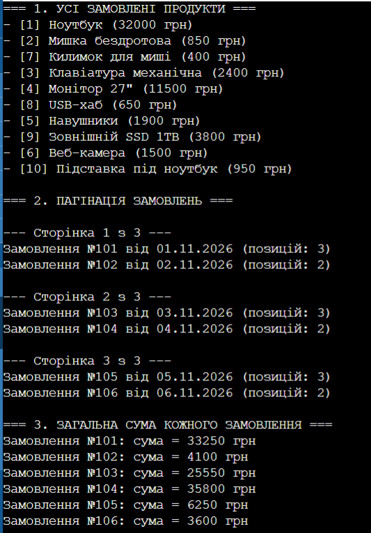

# Лабораторна робота №16. LINQ: SelectMany, пагінація й custom extensions

Варіант: 2. Замовлення та деталі замовлень з продуктами  

Мова програмування: C#  

## Мета роботи

Навчитися використовувати оператор `SelectMany` для роботи з вкладеними колекціями, реалізовувати пагінацію даних за допомогою LINQ, а також створювати власні методи розширення для `IEnumerable<T>` або ключових доменних сутностей.

## Опис роботи

Програма демонструє практичне застосування розширених можливостей LINQ для обробки пов'язаних об'єктів на прикладі інтернет-магазину:  

* **Сутності та тестові дані:** Створено три класи для моделювання предметної області: `Product` (товар із назвою та ціною), `OrderDetail` (позиція в замовленні з кількістю одиниць) та `Order` (замовлення, що містить вкладену колекцію деталей `Details`). Сформовано набір із 10 товарів та 6 замовлень, які разом містять 15 позицій.  

* **Розгортання колекцій (`SelectMany`):** За допомогою оператора `SelectMany` усі вкладені списки `Details` із різних замовлень об'єднано в одну плоску послідовність, після чого отримано унікальний перелік замовлених продуктів без дублікатів за допомогою `Distinct()`.  

* **Посторінковий вивід (пагінація):** Реалізовано механізм пагінації для списку замовлень із використанням методів `Skip()` та `Take()`, що дозволяє зручно виводити дані частинами по 2 замовлення на сторінку.  

* **Власний метод розширення (Custom Extension):** Створено статичний клас `OrderExtensions` із методом `TotalOrderAmount()` для типу `IEnumerable<OrderDetail>`, який інкапсулює бізнес-логіку підрахунку повної вартості замовлення з урахуванням ціни та кількості кожного товару.  

* **Демонстрація в `Main`:** У головному методі програми послідовно виконано всі три запити та виведено відформатовані результати в консоль.

### Результат виконання програми
 

## Висновок

Під час виконання лабораторної роботи було освоєно практичні навички роботи зі складними вкладеними структурами даних у C# за допомогою технології LINQ.  

Було розібрано різницю між звичайною проєкцією `Select` та розгортанням колекцій через `SelectMany`, що дозволяє уникати громіздких вкладених циклів `foreach` і писати декларативний, читабельний код. Також на практиці застосовано стандартний підхід до пагінації через `Skip` і `Take`, який є базовим для роботи з великими обсягами даних.  

Створення власного методу розширення `TotalOrderAmount()` показало, як можна органічно доповнювати стандартні можливості `IEnumerable<T>` специфічною бізнес-логікою проєкту, зберігаючи чистоту та гнучкість коду.

## Контрольні запитання

1. Для чого використовується оператор `SelectMany`? Наведіть приклад, що демонструє його відмінність від `Select`.
* Оператор `SelectMany` використовується для проєкції елементів колекції та подальшого об'єднання (flattening) усіх вкладених колекцій в одну плоску послідовність.
* Відмінність від `Select` полягає у структурі результату: якщо викликати `orders.Select(o => o.Details)`, ми отримаємо колекцію списків (`IEnumerable<List<OrderDetail>>`), тоді як `orders.SelectMany(o => o.Details)` розгорне всі внутрішні списки в єдиний суцільний потік елементів (`IEnumerable<OrderDetail>`).

2. Як реалізувати пагінацію даних за допомогою LINQ? Які методи для цього використовуються?
* Пагінація реалізується комбінацією двох методів розбиття: `Skip()` та `Take()`.
* Метод `Skip((pageNumber - 1) * pageSize)` пропускає задану кількість елементів з попередніх сторінок, а `Take(pageSize)` вибирає рівно стільки записів, скільки потрібно відобразити на поточній сторінці.

3. Поясніть концепцію методів розширення. Як вони інтегруються з LINQ?
* Методи розширення (Extension Methods) дозволяють додавати нові методи до вже існуючих класів або інтерфейсів без зміни їхнього вихідного коду, перекомпіляції чи створення похідних класів. Вони оголошуються як `static` методи всередині `static` класу, а перед першим параметром ставиться ключове слово `this`.
* Уся бібліотека LINQ побудована саме на методах розширення для інтерфейсу `IEnumerable<T>` (таких як `Where`, `Select`, `Sum`), що дозволяє об'єднувати стандартні та власні методи в єдині ланцюжки викликів.

4. Наведіть приклад власного методу розширення для `IEnumerable<T>` та поясніть його призначення.
* У даній роботі реалізовано метод розширення `public static decimal TotalOrderAmount(this IEnumerable<OrderDetail> details)`.
* Його призначення — автоматично обчислювати загальну грошову суму для будь-якої колекції позицій замовлення (множачи ціну кожного товару на його кількість і підсумовуючи результат). Завдяки цьому у коді можна лаконічно викликати `order.Details.TotalOrderAmount()`.
