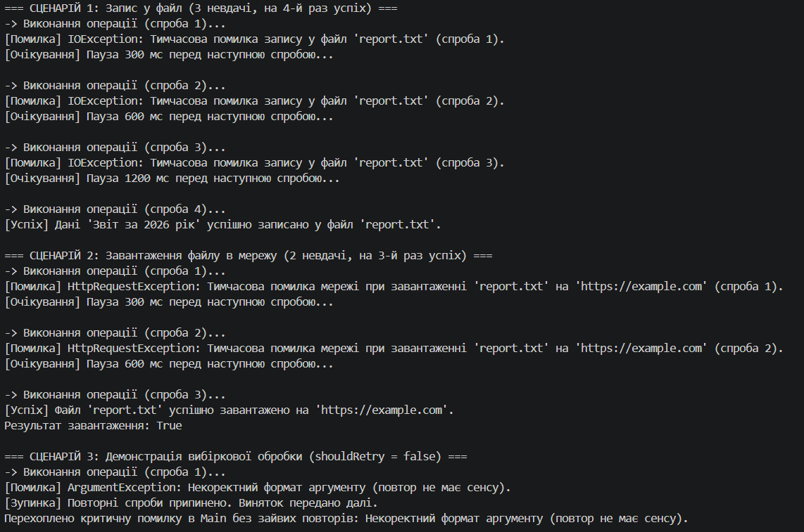

# Лабораторна робота №17. Обробка IO/мережевих помилок та патерн Retry

Варіант: 2. Запис у файл  

Мова програмування: C#  

## Мета роботи

Навчитися обробляти типові помилки вводу/виводу та мережеві помилки за допомогою блоків `try-catch-finally`, а також реалізувати патерн Retry з експоненційною затримкою для підвищення відмовостійкості застосунків.

## Опис роботи

Програма демонструє реалізацію механізму відмовостійкості при роботі з файловою системою та мережею:

* **Клас `FileProcessor`:** Імітує запис даних у файл через метод `WriteToFile(string path, string content)`. Перші 3 виклики генерують виняток `IOException`, а 4-й завершується успішним записом.
* **Клас `NetworkClient`:** Імітує відправку файлу на сервер через метод `UploadFile(string url, string filePath)`. Перші 2 виклики генерують мережевий виняток `HttpRequestException`, а 3-й повертає `true`.
* **Узагальнений клас `RetryHelper`:** Містить статичний метод `ExecuteWithRetry<T>`, який приймає делегат операції `Func<T>`, максимальну кількість повторів `retryCount`, початкову затримку `initialDelay` та фільтр винятків `shouldRetry`. У разі виникнення дозволеної помилки метод логує її та збільшує час очікування перед кожною наступною спробою за формулою експоненційної затримки (`initialDelay * 2^(attempt - 1)`).
* **Демонстрація в `Main`:** Перевірено три сценарії: успішний запис у файл після 3 збоїв, успішне завантаження файлу в мережу після 2 збоїв, а також миттєве переривання без повторів при виникненні критичної помилки `ArgumentException`, яка не підпадає під умову `shouldRetry`.

### Результат виконання програми
 

## Висновок

Під час виконання лабораторної роботи було реалізовано патерн Retry з експоненційною затримкою для обробки тимчасових збоїв вводу/виводу та мережі. Принцип експоненційної затримки полягає в тому, що після кожної невдалої спроби час очікування подвоюється (наприклад, 300 мс, 600 мс, 1200 мс). Це дозволяє уникнути перевантаження сервера або файлової системи частими повторними запитами та дає системі час на відновлення працездатності. Використання делегата `shouldRetry` забезпечило гнучку фільтрацію помилок, дозволяючи повторювати лише тимчасові збої (`IOException`, `HttpRequestException`) і одразу зупиняти виконання при критичних помилках логіки.

## Контрольні запитання

1. Які типи винятків найчастіше виникають при роботі з файлами та мережею?
* При роботі з файлами та потоками вводу/виводу найчастіше виникають `IOException`, `FileNotFoundException`, `DirectoryNotFoundException` та `UnauthorizedAccessException`.
* При мережевій взаємодії типовими є `HttpRequestException`, `SocketException` та `TimeoutException`.

2. Поясніть принцип роботи патерну Retry. Коли його доцільно використовувати?
* Патерн Retry полягає в автоматичному повторному виконанні операції, яка завершилася невдачею, через певні проміжки часу до досягнення успіху або вичерпання ліміту спроб.
* Його доцільно використовувати лише для тимчасових (транзитних) збоїв, які можуть зникнути самі по собі (наприклад, короткочасна втрата інтернету, блокування файлу іншим процесом або тимчасове перевантаження сервера).

3. Як реалізувати експоненційну затримку між повторними спробами?
* Для цього початковий інтервал очікування множиться на двійку у степені номера поточної невдалої спроби: `delay = initialDelay * Math.Pow(2, attempt - 1)`. Таким чином інтервал зростає в геометричній прогресії (наприклад: 200 мс → 400 мс → 800 мс → 1600 мс).

4. Для чого потрібен делегат `shouldRetry` у допоміжному класі `RetryHelper`?
* Делегат `Func<Exception, bool> shouldRetry` виступає фільтром винятків. Він дозволяє визначити, чи має сенс повторювати операцію для конкретного типу помилки. Наприклад, якщо виникла мережева помилка — повторюємо, а якщо передано неправильні вхідні дані (`ArgumentException`) або файл заблоковано назавжди — повторні спроби не допоможуть, тому операція одразу переривається.
